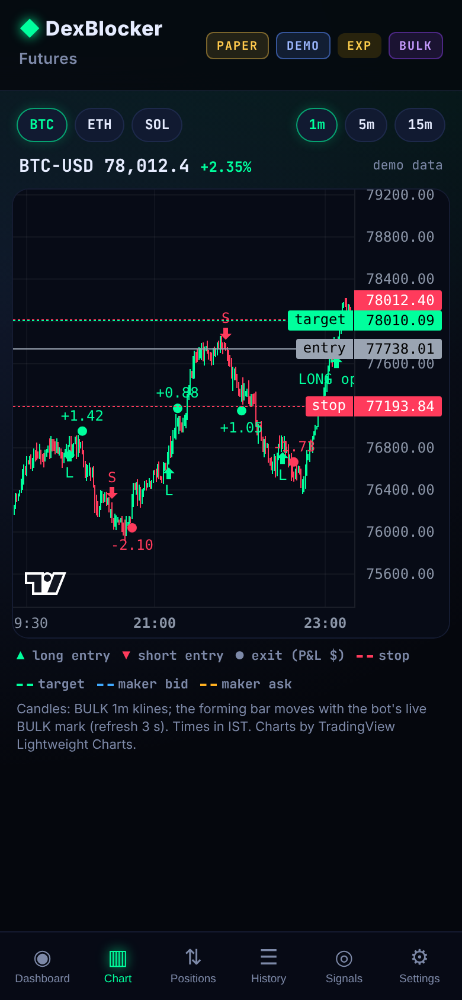
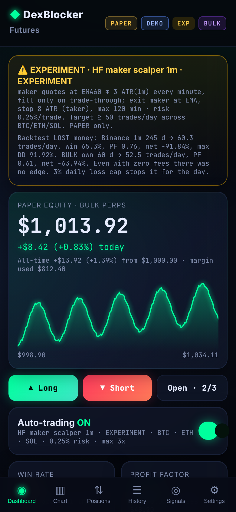
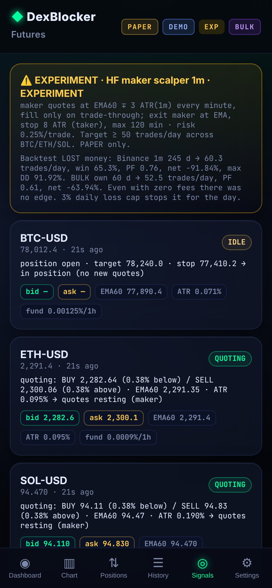

# HF maker scalper (`hf_maker`) backtest - 2026-11-02

Owner request: a paper-only EXPERIMENT with >= ~50 trades/day across BTC/ETH/SOL on BULK, long + short, <= 3x, small risk.
Script: `python bot/research/hf.py --final --binance DIR_WITH_1m_ZIPS --funding DIR_WITH_{SYM}_15m.json --bulk bot/data/backtest --out hf.md`
(grid: drop `--final`). Data: Binance USDT-M 1m klines 2026-03-01 -> 2026-10-31 (245 d, data.binance.vision) and BULK's own
1m candles 2026-09-03 -> 2026-11-02 (60 d). Funding from Binance (8h) / reference venue.

Fill model (deliberately conservative): signal on the 1m close; post-only (ALO) maker quotes valid for the next minute only and
only on the passive side of the close; a maker quote or target fills ONLY if price trades THROUGH it by 1 bp (touch = no fill);
after an entry fill the stop is checked against the rest of that bar; stops and 120-min time exits are taker (3.5 bps + 1 bp
slippage). Risk 0.25 %/trade (stop + round-trip taker fees), notional <= equity x 3 / 3, max 3 open (one per coin),
3 % daily loss cap (IST day), 4-loss streak -> 30-min pause. Start $1,000. "fees $" is absolute USD paid on a shrinking account.

## Result for the live default (EMA60 -/+ 3 ATR quotes, exit at EMA60, 8 ATR stop, 120 min max hold)
| data | scenario | trades/day | win % | PF | avg R | net % | max DD % | fees $ | days stopped by 3% cap | streak pauses |
|---|---|---|---|---|---|---|---|---|---|---|
| binance 245 d | live: maker entry+target (trade-through 1 bp), breakers ON (3% day cap, 4-loss -> 30 min pause) | 60.3 | 65.3 | 0.76 | -0.067 | -91.84 | 91.92 | 274.86 | 31 | 410 |
| binance 245 d | same, breakers OFF (raw edge) | 64.1 | 65.4 | 0.77 | -0.064 | -92.15 | 92.22 | 286.99 | 0 | 0 |
| binance 245 d | same, 4-loss breaker = rest of day (old rule) | 29.1 | 64.7 | 0.73 | -0.076 | -74.61 | 74.76 | 213.25 | 1 | 211 |
| binance 245 d | pessimistic maker: trade-through 3 bp | 49.2 | 61.4 | 0.64 | -0.114 | -96.88 | 96.91 | 188.42 | 36 | 406 |
| binance 245 d | optimistic maker: any trade-through (0 bp) | 66.5 | 67.9 | 0.85 | -0.039 | -79.83 | 80.24 | 390.25 | 21 | 397 |
| binance 245 d | TAKER entries+targets (3.5 bps + 1 bp slip each) | 41.0 | 67.5 | 0.46 | -0.174 | -98.76 | 98.76 | 849.23 | 73 | 252 |
| binance 245 d | gross: zero fees, zero slippage, touch fills | 69.5 | 68.6 | 0.94 | -0.015 | -49.14 | 51.49 | 0.0 | 0 | 0 |
| bulk 60 d | live: maker entry+target (trade-through 1 bp), breakers ON (3% day cap, 4-loss -> 30 min pause) | 52.5 | 62.3 | 0.61 | -0.129 | -63.94 | 64.23 | 124.95 | 19 | 93 |
| bulk 60 d | same, breakers OFF (raw edge) | 63.1 | 62.2 | 0.6 | -0.128 | -70.47 | 70.83 | 129.78 | 0 | 0 |
| bulk 60 d | same, 4-loss breaker = rest of day (old rule) | 28.4 | 63.0 | 0.61 | -0.122 | -40.83 | 41.2 | 84.57 | 0 | 47 |
| bulk 60 d | pessimistic maker: trade-through 3 bp | 41.2 | 57.1 | 0.48 | -0.19 | -69.35 | 69.48 | 101.82 | 21 | 95 |
| bulk 60 d | optimistic maker: any trade-through (0 bp) | 61.1 | 65.9 | 0.7 | -0.085 | -54.57 | 55.47 | 140.62 | 12 | 88 |
| bulk 60 d | TAKER entries+targets (3.5 bps + 1 bp slip each) | 47.8 | 65.8 | 0.28 | -0.235 | -81.52 | 81.6 | 583.23 | 42 | 68 |
| bulk 60 d | gross: zero fees, zero slippage, touch fills | 69.5 | 65.5 | 0.75 | -0.074 | -54.27 | 55.67 | 0.0 | 0 | 0 |

## What was tried before picking it (all lose)
- First grid (`hf.py` without `--final`, 112 runs = 56 configs x Binance/BULK): 1m maker mean reversion (bands 1.5-2.5 ATR,
  stops 1.5-3 ATR, EMA20/60, with/without 15m trend filter) and taker variants - every run lost, -70.5 % to -99 %, best PF 0.71.
- Momentum (1m Donchian breakout, taker or maker entries, 96 runs): with real costs best PF 0.71 (Binance) / 0.56 (BULK), net
  -90 % to -99 %. Gross (zero fees, zero slippage, touch fills): best PF 0.98 on Binance = no edge before costs. BULK's own
  candles showed gross momentum PF 1.14 (+124 %), but it disappears with costs and is likely an artifact of BULK's thinner candles.
- Wider mean-reversion bands/stops (72 runs, explore3): best PF 0.82 Binance / 0.70 BULK with real costs, all still losing.
- Wider bands/stops reduce the per-trade cost in R (fees are smaller vs. an 8 ATR stop): avg R improved from -0.23 to -0.06,
  still negative. k=3 (instead of 4) was picked only to reach >= 50 trades/day on both data sets (k=4: 46.7/day Binance).
- Maker vs taker: the same rules with taker entries/targets lose ~2x faster (PF 0.46 vs 0.76) - the 0 bps maker fee is the only
  thing that makes this "least bad". The fill assumption matters a lot: 0 bp trade-through PF 0.85, 3 bp trade-through PF 0.64.
- The old "4 losses -> stop for the rest of the day" rule would cut trading to ~29/day (below the 50 target), so for hf_maker the
  streak breaker pauses 30 minutes instead; the 3 % daily loss cap still stops trading for the rest of the IST day
  (31 of 245 days on Binance, 19 of 60 on BULK).

Verdict: no edge. Expect the paper account to lose roughly 0.2-0.5 % per day on average while it runs; it is a paper experiment only.

## Mini App (demo data)
  
